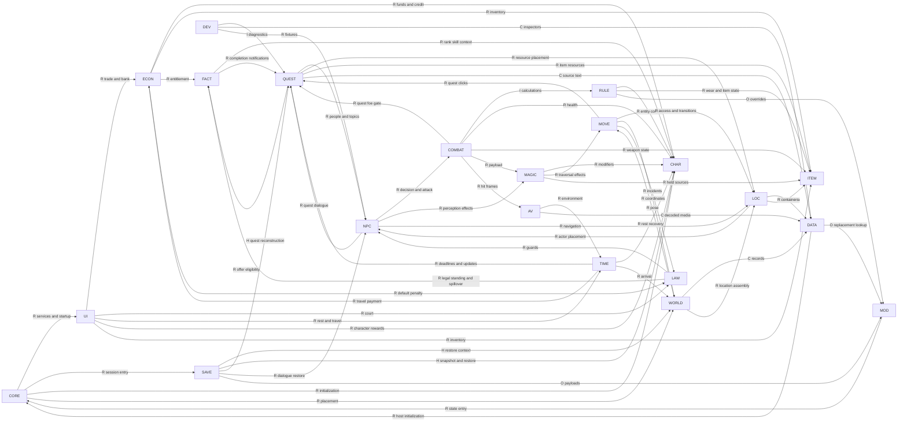
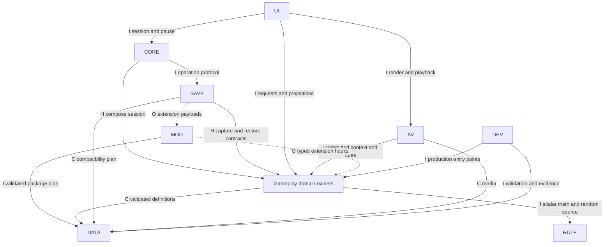

# Detailed dependencies

This cross-system map synthesizes all 21 feature catalogs and architecture reviews. It supplements [the initial handoff overview](02_INITIAL_DEPENDENCY_OVERVIEW.md). Here an arrow **A → B means A depends on B**. This differs from the initial overview's data/control handoff arrows. An event delivered from B to A is represented here as A depending on B's event contract.

Types apply to an edge's named scope. **H** is a hard prerequisite for that operation, **I** is an interface contract, **R** is a live runtime collaborator, **C** is a content dependency, and **O** is optional integration. Several types may apply. An H edge does not mean all of A must wait for all of B to be implemented. The proposed graph is a design proposal, while the existing graph records sampled DFU relationships rather than a complete static call graph.

## Existing DFU graph

## Existing dependency ledger

The ledger adds important scopes omitted from the compact graph. Source paths are relative to `daggerfall-unity-1.1.1-cve-2025/Assets/Scripts` unless stated. Feature IDs link each row to the catalog and its matching system review.

| Consumer | Dependencies by type and scope | Representative evidence |
| --- | --- | --- |
| CORE | H DATA for validated installation, R CHAR/ITEM/MAGIC/QUEST/FACT/ECON/TIME for session initialization, R UI/WORLD/LOC/SAVE for entry and play gating | CORE-004–017. `Game/Utility/StartGameBehaviour`, `Game/GameManager`, `Game/StateManager`. |
| DATA | R CORE initialization, C original archives/packaged resources, O MOD, R CHAR through biography application and macro context | DATA-001–003, 008, 016, 021–024. `DaggerfallUnity.SetupContentReaders`, `API/BiogFile.ApplyEffects`, `Utility/MacroHelper`. |
| RULE | I CHAR/ITEM data models, R CHAR/MAGIC/FACT/ECON context and mutations, O MOD hooks | RULE-005–028. `Game/Formulas/FormulaHelper.CalculateAttackDamage`, `UpdateRegionalPrices`, `GenerateBuildingName`. |
| CHAR | C DATA, I RULE, R MOVE activity/AV feedback/UI progression, R MAGIC/ITEM effects, R TIME, R FACT death prevention | CHAR-011–023. `PlayerEntity`, `DaggerfallCharacterSheetWindow.UpdatePlayerValues`, `GuildManager.AvoidDeath`. |
| ITEM | C DATA templates, I RULE stack/material policy, R CHAR capacity and coin state, R MAGIC equipped/use effects, R QUEST provenance, R TIME expiry/repair, R UI transfer/use policy | ITEM-001–025. `ItemBuilder`, `ItemCollection`, `ItemEquipTable`, `DaggerfallUnityItem`, `DaggerfallInventoryWindow`, `ItemRepairData`. |
| MOVE | H engine physics for motor, R WORLD/LOC geometry, R CHAR capabilities, R MAGIC traversal flags, R NPC/QUEST/ITEM/LAW interaction, R UI input | MOVE-004–027. `PlayerMotor`, `LevitateMotor`, `PlayerActivate`, `PlayerEnterExit`. |
| COMBAT | I RULE, R CHAR/ITEM/MAGIC consequences, R NPC targeting/death, R QUEST foe acknowledgment, R LAW surrender, R AV commitment | COMBAT-004, 009–021. `WeaponManager`, `EnemyAttack`, `DaggerfallMissile`, `EnemyDeath`. |
| MAGIC | C DATA, I RULE, R CHAR/ITEM sources and modifiers, R TIME rounds, R MOVE/WORLD/LOC teleport, R NPC influence, R UI/AV casting | MAGIC-001–010, 016–030. `EntityEffectBroker`, `EntityEffectManager`, `Effects/Mysticism/Teleport`. |
| NPC | C DATA, R WORLD/LOC placement, R CHAR/RULE progression context, R MAGIC/COMBAT behavior, R FACT/QUEST dialogue, R UI | NPC-001–024. `PopulationManager`, `EnemySenses`, `EnemyMotor`, `TalkManager`. |
| QUEST | H DATA scripts, I MOD action templates, R FACT/CHAR eligibility, R TIME clocks, R WORLD/LOC sites, R NPC/ITEM/COMBAT resource state, R ECON/LAW/MAGIC/MOVE actions, R UI | QUEST-001–023. `QuestListsManager`, `QuestMachine`, `Task`, `Place`, `Actions/`. |
| FACT | C DATA faction graph, R CHAR skills/player regional state, R TIME political updates, R QUEST completion, R ECON/MAGIC benefits, R UI service tokens | FACT-001–018. `PersistentFactionData`, `Guild`, `GuildManager`, `Temple`, `KnightlyOrder`. |
| LAW | R CHAR current charge/legal records, R FACT spillover/rescue, R NPC guards, R COMBAT surrender, R TIME sentence, R MOVE/WORLD release, R UI court | LAW-001–016. `PlayerEntity`, `EnemyAttack`, `DaggerfallCourtWindow`. |
| ECON | I RULE prices, R CHAR carried funds, R ITEM goods/credit, R FACT entitlements, R LAW default, R TIME deadlines, R WORLD/LOC property, R UI settlement | ECON-001–019. `DaggerfallTradeWindow`, `DaggerfallBankManager`, `LoanChecker`, `DaggerfallTavernWindow`. |
| WORLD | H DATA records, R LOC exterior assembly, R MOVE pose, R NPC/ITEM registries, R QUEST discovery consumers, R AV terrain resources, R SAVE durable loose objects | WORLD-001–018. `StreamingWorld`, `FloatingOrigin`, `PlayerGPS`, `TerrainNature`. |
| LOC | H DATA block records, R WORLD residency, R MOVE doorway context, R NPC/ITEM population, R QUEST markers, R MAGIC/COMBAT traps, R AV motion | LOC-001–020. `DaggerfallInterior`, `DaggerfallDungeon`, `RMBLayout`, `RDBLayout`, `DaggerfallAction`. |
| TIME | I DATA/RULE calendar and weather inputs, R WORLD context, R CHAR/MAGIC rest/arrival, R QUEST explicit rest ticks, R ECON/FACT transport terms, R UI pacing | TIME-001–018. `WorldTime`, `WeatherManager`, `DaggerfallRestWindow`, `TravelTimeCalculator`, `DaggerfallTravelPopUp`. |
| UI | I DATA localization/fonts, R CORE/MOVE focus/pause, R CHAR/ITEM/NPC/QUEST/ECON/MAGIC/WORLD/LOC/TIME/LAW flows, O MOD factory, R AV rendering | UI-001–021. `UserInterfaceManager`, `DaggerfallUI`, feature windows. |
| AV | C DATA media, R WORLD/LOC/TIME environment, R MOVE/COMBAT/MAGIC cues, R UI composition/cinematics, O MOD replacements | AV-001–013. `RetroRenderer`, `DaggerfallAudioSource`, `DaggerfallSongPlayer`, `DaggerfallVidPlayerWindow`. |
| SAVE | H owner state for the selected save scope, H WORLD/LOC/MOVE readiness on native restore, R CHAR/ITEM/MAGIC/QUEST/FACT/LAW/ECON/NPC/TIME, R UI/AV previews, O MOD sidecars | SAVE-006–018. `SaveLoadManager`, `SerializablePlayer`, `SerializableStateManager`, classic import. |
| MOD | R CORE lifecycle, H DATA/bundle metadata for package resolution, I owner registries, O SAVE payload integration, R UI configuration and editor packaging | MOD-001–016. `Assets/Game/Addons/ModSupport/ModManager`, `Mod`, `ModTypes`. |
| DEV | I/R all inspected owners for diagnostics and fixtures, C DATA for editors, O rendered evidence and packaging | DEV-001–014. `GenerateDiagLog`, console registry, `SetupDemoEnemy`, editor windows and embedded package tests. |

These dependencies are supported at named call paths. They do not establish that each system owns a persistent copy of its collaborator's state. See [the ownership table](architecture/GLOBAL_ARCHITECTURE_REVIEW.md).

## Proposed dependency graph

This graph shows the main structural dependencies. `DOMAINS` expands to CHAR, ITEM, COMBAT, MAGIC, NPC, QUEST, FACT, LAW, ECON, WORLD, LOC, MOVE and TIME. It is a notation group, rather than a proposed central module. Runtime cycles are detailed below and are not removed by drawing interfaces.

| Contract scope | Directed dependency and type | Rationale, cost and relevant proposal |
| --- | --- | --- |
| World assembly | LOC → DATA (H,C), WORLD → LOC (I,R) | WORLD requests local layout through a contract. LOC consumes an explicit world context, rather than reaching back through the streaming singleton. Adds context plumbing. GAD-07. |
| Movement and placement | MOVE → WORLD/LOC (I,R), WORLD/LOC → AV (I,R engine assembly support) | Physics requires geometry and environment readiness. Rendering resources remain separate from semantic location identity. Headless fixtures still need a physics substitute. GAD-07/11. |
| Actor simulation | NPC → CHAR/MOVE (I,R), NPC → COMBAT/MAGIC (I,R intent), COMBAT → CHAR/ITEM/MAGIC (I,R consequence) | Keep AI decision separate from commitment. MAGIC and COMBAT can collaborate through explicit phases with guarded reentry. GAD-02/09. |
| Equipment | ITEM → MAGIC (I,R held-effect handoff), MAGIC → ITEM (I,R source query) | A real runtime cycle remains. Slots commit before held-effect reconciliation, and restore stages base items before live effects. Cleanup failure needs a policy. GAD-02/04/08. |
| Death and quest resources | COMBAT → QUEST (I,R death signal), QUEST → NPC/ITEM/LOC (I,R resource operations) | Quest acknowledgment cannot leave corpse finalization indefinitely ambiguous. Define bounded deferred state or an error outcome. More state is required than an untracked callback. GAD-09. |
| Offers and rewards | QUEST → FACT/CHAR (I,R eligibility), QUEST → ECON/ITEM (I,R reward), NPC → QUEST (I,R offer/response) | FACT consumes committed completion facts for guild policy. Quest state and membership retain separate owners. Avoid reentering quest mutation from its own notification. GAD-08/09. |
| Crime and guards | LAW → FACT (I,R spillover), LAW → NPC (I,R deployment), COMBAT/MOVE/ITEM/ECON → LAW (I,R incident) | LAW decides legal consequences while NPC supplies actors. A detected theft and a loan default remain different legal inputs. GAD-02/08. |
| Economy | ECON → ITEM/FACT (I,R goods and entitlement), ECON → TIME (I clock query) | TIME delivers elapsed boundaries through registered owner contracts and does not own accounts. Receipt policy adds complexity only when retry requires it. GAD-05/08. |
| Rest and travel | TIME → CHAR/MAGIC/QUEST (I,R progression/interruption), TIME → ECON (I,R payment), TIME → WORLD/LOC/MOVE (I,R placement) | High-level activity orchestration stays bounded to the operation. Low-level clock arithmetic does not acquire these dependencies. GAD-03/05/07. |
| Presentation | UI/AV → owner projections (I), owners → presentation ports (O notification sink) | Owners can run with a recording or absent presentation consumer. Typed commitment markers remain available where visuals supply timing. GAD-09/11. |
| Modding | MOD → owner registration interfaces (O), DATA → resolved package plan (C) | Package planning happens before frozen definition publication. No runtime requirement for every domain to query the mod singleton. More upfront validation. GAD-10. |
| Persistence | SAVE → owner codecs/projections (H,I), owners → small persistence value contracts (I) | Domain meaning remains local. Schema contract data must not import SAVE orchestration back into every owner. GAD-04. |

## Critical cycles and staging

The observed CORE/UI/SAVE loop couples navigation, pause and session load. The WORLD/LOC/MOVE/SAVE cluster couples readiness, identity and reconstruction. CHAR/ITEM/MAGIC/COMBAT links base state, derived modifiers and health consequences. QUEST/NPC/FACT/LOC links selection, conversation, resource placement and completion. TIME/ECON/LAW/FACT/CHAR links deadlines, penalties and time jumps. These are runtime collaboration clusters, inferred from the ledger. They are not a formally computed set of assembly dependency components.

Use contracts and staged activation to contain those cycles. Resolve content first, construct base state second, register identities third, and only then activate dependent behavior. A DI framework, event bus or generic entity framework cannot by itself resolve order-sensitive writes. The cost is explicit phase and failure state, as proposed in GAD-02 through GAD-09.

## Potentially concurrent development domains

These are future development domains, rather than implementation tasks. Independence is conditional on the listed contracts and fixtures.

| Domain | Contracts needed first | Work that can be isolated and later integration seam |
| --- | --- | --- |
| Data validation and localization | Definition/package keys, token representation and source policy | Format decoders, validators and translation conversion can use fixture data. Later integrate package resolution and UI fonts. |
| Character rules and inventory | Actor/item identity, ownership and operation outcomes | Progression calculations and collection/equipment behavior can use explicit data and fake effect hooks. Later integrate MAGIC, ECON and SAVE. |
| World/location generation | Coordinates, layout IDs, residency and readiness | Tile samples and local layout descriptions can use fixture inputs. Later integrate MOVE collision, dynamic NPC/ITEM placement and QUEST markers. |
| Presentation and shell | UI lifecycle, projections, cue and playback outcomes | UI views and AV prototypes can consume recorded projections. Later integrate committed gameplay operations and real render resources. |
| Faction/legal/economic rules | Clock contract, character queries, standing and payment boundaries | Rank, propagation, quote and sentence calculations can progress separately. Their settlement and guard flows require joint integration. |
| Quest and dialogue | Stable action/resource IDs, time and owner operation contracts | Parsing, task ordering and structured conversation can use fake owner results. World binding, offers and restoration require joint fixtures. |
| Persistence protocol and diagnostics | Owner projection envelope, ID and version policy | Publication/recovery and format validation can use synthetic payloads. Full restore needs real owners and world readiness. |

COMBAT, MAGIC and NPC can develop individual calculations concurrently after actor, item, effect and timing contracts settle. Their full attack/death behavior is an integration cluster. SAVE schema, package identity, coordinate semantics and time ordering are early joint decisions because late changes affect several domains. Performance indexes, broad executable mod APIs and specialized authoring tools can be deferred with the trade-offs recorded in [architectural decisions](architecture/ARCHITECTURAL_DECISIONS.md).
