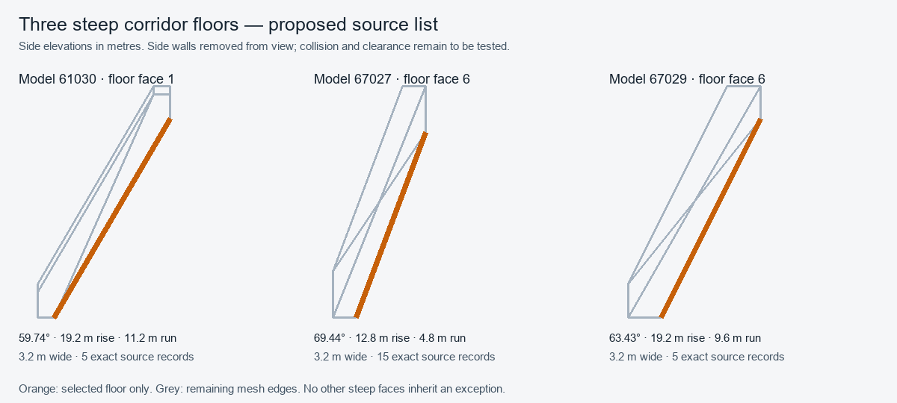

# IMP-012 steep ramp source review — 2026-11-24

The user requested that the pending list be determined now, after reporting all
eight increment-2 human checks PASS. This follow-up identifies a concrete proposed
list: **three corridor floor faces, in 25 exact source records across 16 blocks**.
It does not enable runtime exceptions or claim production traversal qualification.

**2026-11-25 follow-up:** The user subsequently confirmed the three corridor
designs and authorized runtime implementation and placement checking. See the
[implementation evidence](IMP-012-steep-connectors-2026-11-25.md) and
[playable review](IMP-012-STEEP-CONNECTORS-REVIEW-2026-11-25.md). The source-only
status below is historical; its diagrams, exact list and input hashes remain
valid. New human review and full assembled-route acceptance remain open.



## Proposed list and rationale

| Model | Original floor plane (zero based) | Geometric slope | Width | Rise / horizontal run | Source records (border / other) |
| --- | ---: | ---: | ---: | ---: | ---: |
| 61030 | 1 | 59.743563° | 3.2 m | 19.2 / 11.2 m | 5 (3 / 2) |
| 67027 | 6 | 69.443955° | 3.2 m | 12.8 / 4.8 m | 15 (11 / 4) |
| 67029 | 6 | 63.434949° | 3.2 m | 19.2 / 9.6 m | 5 (1 / 4) |

These are hollow corridor pieces with side walls, a ceiling, open ends and a
continuous rectangular floor joining different elevations. The steep face is the
floor of that passage, rather than a rock, wall or bevel beside a normal floor.
Source mesh topology and elevations support selecting those faces as traversal
routes. This is an explicit engineering recommendation, not an angle detector or
proof that every instantiated passage is reachable or essential to every quest.

The original investigation's 69° example was model 67027's actual floor. Its
63.535116° stored-normal estimate for model 67029 is slightly different from the
63.434949° geometric plane; the list records both. Collision geometry, rather than
rounded original lighting normals, must govern physical traversal.

All 25 records are static and use yaw rotation only. Fifteen occur in nine border
blocks; ten more use exactly the same corridor pieces in normal, wet or quest
blocks. Recommend including those ten exact records too: excluding them solely
because the block name is not a border would leave the same passage floor blocked.
This does not authorize every occurrence of a model ID, a block-wide exception,
other faces of these models, moving objects or replacement meshes.

## Coverage and negative scope

The read-only scan covers **all 187 pinned RDB blocks**, including all 15 border
blocks, 22,961 model occurrences and 1,043 distinct referenced model IDs. There are
3,053 occurrences with upward-facing source normals strictly between 45° and 90°.
All duplicate ARCH3D model-ID variants are retained in the geometric inventory;
the three selected IDs each resolve uniquely. No unknown action or axis is
reclassified or executed by this observation.

Across the border blocks, all 15 such steep occurrences belong to these three
models and selected floors. Other blocks contain many additional steep faces,
including narrow corridor bevels (for example 63040 planes 1/3), rock/cave faces,
stairs and decorative objects. They remain outside the list. Even an angle match
or the same source description does not qualify a face.

The [source report](IMP-012-steep-ramp-source-list-2026-11-24.json) pins archive,
block, model and current stable-mapping hashes; each proposed record includes its
stable block/record identity, source address, model, exact floor plane, position
and rotation. It also retains the complete steep-normal inventory grouped by
model/rotation and source occurrence. The source values are observations of the
user's classic files; the selection and reporting code are project-authored.
No classic/reference bytes, game code or movement definitions were changed.

## Qualification still required before enabling

The source-list identification work is now concrete and reviewable. Production
qualification remains separate: LOC must resolve the approved source face on the
actual placed collision shape, with verified source/placement identity and
current content publication. Changed blocks, changed models, loose/mod overrides,
replacement meshes and stale contexts must not inherit a stale exception.

Real MOVE capsule tests must demonstrate both directions, full clearance at the
ends/seams and roof, deliberate crouch where applicable, normal surface-tangent
gait speed and actual CHAR activity. Wall/ceiling/adjacent ordinary steep faces,
unlisted records, changed geometry and ordinary non-dungeon slopes must reject
uphill traversal. Use independent headless and rendered commands and Windows
export checks for the eventual runtime change. Source inspection and this diagram
are not substitutes for those checks. No claim of complete assembled-layout,
native SAVE, parent IMP-012 or M2 readiness is made.

## Reproduction

Run from the repository root, supplying new output paths:

```powershell
& C:/Users/Kirk/.cache/codex-runtimes/codex-primary-runtime/dependencies/python/python.exe main_project/tools/observe_steep_ramp_list.py C:/Games/Daggerfall/arena2 NEW_REPORT.json NEW_DIAGRAM.png
```

The source scan uses Python's standard library and existing independent source
decoders. Optional diagram rendering uses the bundled Pillow and Windows Arial;
it adds no game dependency. The script refuses existing output paths. Fresh-run
report equivalence and diagram reproduction were checked; no Godot suite is
claimed for this source-only follow-up. The earlier increment-2 runtime/manual
results remain recorded separately.

## Exact proposed source records

Rows below are source block templates, not a claim that 25 total instances exist
across all assembled dungeons. A runtime rule must bind the particular placed
instance and validated face to its unchanged source template.

| Block | Stable block / record | Source address | Model | Floor plane |
| --- | --- | ---: | ---: | ---: |
| B0000005.RDB | block-0913 / record-00052 | 11750 | 67027 | 6 |
| B0000006.RDB | block-0914 / record-00002 | 9644 | 67027 | 6 |
| B0000006.RDB | block-0914 / record-00055 | 11846 | 67027 | 6 |
| B0000007.RDB | block-0915 / record-00007 | 9859 | 67027 | 6 |
| B0000007.RDB | block-0915 / record-00035 | 11032 | 67027 | 6 |
| B0000008.RDB | block-0916 / record-00001 | 9644 | 67027 | 6 |
| B0000008.RDB | block-0916 / record-00023 | 10506 | 67027 | 6 |
| B0000008.RDB | block-0916 / record-00036 | 11080 | 67027 | 6 |
| B0000009.RDB | block-0917 / record-00007 | 9859 | 67027 | 6 |
| B0000009.RDB | block-0917 / record-00028 | 10696 | 67027 | 6 |
| B0000010.RDB | block-0918 / record-00006 | 9859 | 67027 | 6 |
| B0000010.RDB | block-0918 / record-00026 | 10648 | 67029 | 6 |
| B0000011.RDB | block-0919 / record-00046 | 11412 | 61030 | 1 |
| B0000012.RDB | block-0920 / record-00002 | 9644 | 61030 | 1 |
| B0000013.RDB | block-0921 / record-00002 | 9644 | 61030 | 1 |
| N0000018.RDB | block-0941 / record-00015 | 9955 | 61030 | 1 |
| N0000057.RDB | block-0980 / record-00065 | 11306 | 67029 | 6 |
| N0000058.RDB | block-0981 / record-00079 | 11797 | 67029 | 6 |
| N0000059.RDB | block-0982 / record-00070 | 11797 | 67029 | 6 |
| W0000014.RDB | block-1030 / record-00080 | 11306 | 67029 | 6 |
| W0000025.RDB | block-1041 / record-00032 | 9955 | 61030 | 1 |
| S0000004.RDB | block-1059 / record-00016 | 33110 | 67027 | 6 |
| S0000004.RDB | block-1059 / record-00017 | 33062 | 67027 | 6 |
| S0000004.RDB | block-1059 / record-00089 | 32966 | 67027 | 6 |
| S0000004.RDB | block-1059 / record-00090 | 32918 | 67027 | 6 |
